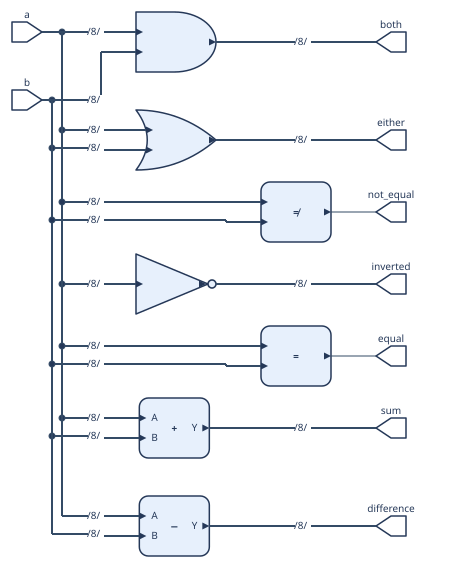

# Circuit Diagram DSL

`cdiag` turns a small text description of a digital system into an SVG block diagram. Describe the blocks you want readers to see and connect their ports. The output is a diagram, not HDL: it does not simulate or synthesize the design.

## Your first diagram

Save this as `hello.cdl`:

```text
diagram "A small datapath" {
    direction LR

    input left[8], right[8]
    output result[8]

    sum: ADD(width=8)
    left -> sum.A
    right -> sum.B
    sum.Y -> result
}
```

Render it to SVG:

```sh
docker compose run --rm typescript
docker compose run --rm typescript npm run cdiag -- render hello.cdl -o build/hello.svg
```

The first command builds the TypeScript package. For local development with Node.js installed, run `npm install` and `npm run build` once, then use `npm run cdiag -- render hello.cdl -o build/hello.svg`. Open the resulting SVG in a browser or any SVG viewer.

The repository includes larger examples and their rendered diagrams:

- [`simple_riscv_datapath.cdl`](examples/simple_riscv_datapath.cdl) — a small RISC-V datapath.
- [`logic_primitives.cdl`](examples/logic_primitives.cdl) — logic gates and comparators.
- [`streaming_fir.cdl`](examples/streaming_fir.cdl) — a three-tap FIR pipeline.
- [`dma_engine.cdl`](examples/dma_engine.cdl) — a DMA controller and memory interface.
- [`bit_manipulation.cdl`](examples/bit_manipulation.cdl) — bus concatenation, slices and shifts.



## Describe blocks and connections

Start a CDL file with `diagram`. The `version 1` line in older files is optional. Inside the diagram, declare top-level `input` and `output` ports, then blocks and connections.

```text
diagram "Execution path" {
    input a[32], b[32], select
    output result[32]

    choose: MUX(width=32)
    execute: ALU(width=32, op_width=4)

    a -> choose.A, execute.A
    b -> choose.B
    select -> choose.S
    choose.Y -> execute.B
    execute.Y -> result
}
```

`source -> sink` connects ports. A source can drive multiple sinks, for example `a -> choose.A, execute.A`. Ports on built-in blocks use names such as `A`, `B` and `Y`; custom blocks let you choose names that fit your design:

```text
instruction_memory: box "Instruction Memory" {
    in ADDR[32]
    out INSTR[32]
}
pc[32] -> instruction_memory.ADDR
```

Use `in` and `out` for custom block ports. Widths may be written in square brackets; if a width is omitted, the compiler attempts to infer it from connections.

## Concatenate and slice buses

Use a slice to select a bit range or a single bit. Bit indices start at zero, and both ends of a range are included. Use braces to concatenate signals; the first item is the most significant part.

```text
diagram "Packet fields" {
    input tag[4], payload[12], packet[16]
    output assembled[16], packet_tag[4], packet_payload[12], valid[1]

    net assembled_packet[16] = {tag, payload} -> assembled
    packet[15:12] -> packet_tag
    packet[11:0] -> packet_payload
    packet[15] -> valid
}
```

Here `tag` occupies bits 15–12 of `assembled`, and `payload` occupies bits 11–0. A one-bit selection such as `packet[15]` has width one. Slices require the source port to have an explicit width. The compiler checks widths and slice bounds, and rejects conflicting drivers.

The split and join symbols turn with `direction`. In a vertical diagram, the
bus bar is horizontal and wires enter and leave along the flow axis.

## Built-in blocks

The `circuit` and `microarchitecture` modes use the same built-in blocks, port names, width checks and symbols. `n` means `width`; defaults are 32 bits for `width`, 12 bits for `addr_width`, and 4 bits for `op_width`. Shift amount width defaults to `ceil(log2(width))`, with a minimum of one bit.

| Block | Ports (`→` means output) | Parameters |
|---|---|---|
| `ADD` | `A[n], B[n] → Y[n]` | `width` |
| `SUB` | `A[n], B[n] → Y[n]` | `width` |
| `AND`, `OR`, `XOR` | `A[n], B[n] → Y[n]` | `width` |
| `NOT` | `A[n] → Y[n]` | `width` |
| `SHIFT`, `SHL`, `SHR`, `SAR` | `A[n], B[m] → Y[n]` | `width`, `shamt_width` |
| `CMP` | `A[n], B[n] → Y[1]` | `width`, `op` (`eq` or `ne`; default `eq`) |
| `MUX` | `A[n], B[n], …, S[k] → Y[n]` | `width`, `inputs` (2–16, default 2) |
| `ALU` | `A[n], B[n], OP[op_width] → Y[n]` | `width`, `op_width` |
| `DFF` | `D[n], CLK[1] → Q[n]` | `width` |
| `SRAM` | `ADDR[addr_width], WDATA[n], WE[1], CLK[1] → RDATA[n]` | `width`, `addr_width` |
| `MATCH` | `QUERY[n], DATA[entries × n] → MATCH[entries]` | `entries`, `width` (both default to 8) |
| `PRIORITY` | `MATCH[entries] → INDEX[max(1, ceil(log2(entries)))], VALID[1]` | `entries` (defaults to 8) |

Use `box "Label" { ... }` for a component that is not a built-in. Port sides can be set with `@west`, `@east`, `@north` or `@south`, for example `in CLK@north`. Built-in symbols may hide their port names in the rendered SVG; the names remain available in the DSL for connections.

Small triangles point into a block at inputs and out of it at outputs.
A `MUX` keeps the same slanted edge angle as it grows to fit more inputs.
Its select port `S` uses `ceil(log2(inputs))` bits. In either mode, placing
all data inputs on the north side and `Y` on the south side turns the symbol:

```text
select: MUX(width=8) { in A@north, B@north, S@west out Y@south }
```

`MATCH` represents one equality comparison per entry. `PRIORITY` represents
selection from a match mask. These primitives describe data flow in the
diagram and do not simulate it.

## Address fields and memory arrays

Inside a custom `box`, add `table(...)` to draw address fields or a memory array:

```text
address: box "メモリアドレス" {
    table(columns="タグ|インデックス|ライン内位置")
    out TAG[20]@south, INDEX[8]@south
}
tags: box "タグアレイ" {
    table(columns="|", rows=5, ellipsis=on, brace="セット", indices="0|1|2||n−1")
    in INDEX[8]@west
    out WAY0[20]@south, WAY1[20]@south
}
address.INDEX -> tags.INDEX
```

`columns` separates column labels with `|`; empty labels produce blank columns.
Labels appear in the first display row. `rows` is the number of visible rows
(1–64, default 1), independent of capacity and signal widths. `ellipsis=on`
replaces the penultimate row with a taller row of vertical dots and requires at
least three rows. `indices` supplies one row label per visible row, separated by
`|`; leave the ellipsis label empty. `brace="Text"` adds a left brace and caption;
`brace=""` draws just the brace. Omit it to hide the brace.

Table port names are hidden. North/south ports attach to column centers in
declaration order when they fit, starting with the first column. Otherwise they
are spaced evenly. West/east ports are spaced along the array edge. Use explicit
port sides to connect a field to comparators or a memory index. Titles support
`\n` for line breaks. Routing and placement remain automatic; this feature does
not reproduce a reference image's exact coordinates.

See [the two-way cache](examples/set_associative_cache.cdl) and
[the TLB](examples/tlb.cdl). Both use the same parser, width checks and
Netlist2SVG renderer as ordinary blocks. The examples show structural data flow;
valid bits, replacement logic and page-walk control are omitted. The TLB example
concatenates the physical page number with the original offset.

## Microarchitecture diagrams

Set `mode microarchitecture` inside a diagram to enable structured tables and
address records. Circuit mode remains the default. A
caller can also select the effective mode before validation with
`parse(source, { mode: "microarchitecture" })`, `renderSvg(source, { mode:
"microarchitecture" })`, or the CLI `--mode microarchitecture` option on
`check`, `render`, `bundle`, `dump-ir` and `dump-netlist`.

Structured tables describe fields and signal bindings explicitly:

```text
tags: table "Tagged entries" (selected=1) {
    field valid[1] label "Valid" use "allocated"
    field tag[20] label "Tag" use "address match"
    index SET[7]@west
    read TAGS[2560] from tag all
    write FILL_TAG to tag @north
}
```

The quoted title and table options are optional. `rows` controls visible
rows (default 5, range 1–64). `ellipsis` defaults to on with at least three
visible rows. `selected` is a zero-based display row, excluding the ellipsis
row. Older diagrams can still supply `entries` to set logical capacity and
preserve capacity-based sizing and display defaults.

Each field has a unique identifier and positive width. `label` and `use` are
optional metadata; field labels appear in the SVG, while `use` remains in the
IR. Field declarations can follow their read/write bindings. An `index` port
may omit its width when the connected signal supplies it. An explicitly
sized index such as `index SET[7]` also works. Multiple indices are supported. Tables
without indices represent associative structures. Each index is drawn as a
decoder triangle attached to the table edge, with the input connected at its
apex. Indices default west and may be placed east. `read NAME from field`
produces a field-width output; `read NAME from field all` produces the
concatenated entries vector. With no table capacity, the compiler takes that
width from a connected sized port or from `read TAGS[2560] from tag all`. Other
all-entry reads from the same table cover the same number of entries. Reads
attach at the field column along the bottom.
`write NAME to field` creates a field-width input attached along the top. All
generated vectors are capped at 65,536 bits. Optional sides must be `@south`
for reads and `@north` for writes. Ordinary `in`/`out` control ports are also
allowed. Structured table SVGs show the optional title, field labels (or IDs if
unlabeled) and widths;
capacity, row numbers, index names, binding names and `use` prose are not drawn.

Several `read` bindings can share one `index` (for example, to read tag and
data from the same row). Multiple bindings to the same column get distinct
pins. To draw independent accesses, declare separate indices and link each
addressed read or write to its decoder with `via`:

```text
regs: table "Register file" {
    field value[32]
    index RA[5]@west
    index RB[5]@west
    index WA[5]@east
    read RD_A from value via RA
    read RD_B from value via RB
    write WD to value via WA
}
```

This 2R1W table has two bottom data outputs, one top data input and three
independent address inputs. The `via` names are retained in the IR and the
diagram uses separate connections without port names around the table.
Whole-table `read ... all` bindings do not use an index. The diagram does
not specify timing or read-during-write behavior.

Address records split an input bus into named, MSB-first field outputs:

```text
va: record "Virtual address" {
    field vpn[20] label "VPN" use "translation lookup"
    field offset[12] label "Offset"
}
```

The record creates `IN[32]@north` and one south output per field. The SVG shows
the bit ranges calculated from declaration order. A record is a diagram
decomposition and does not model or simulate a slicing circuit.

Use the shared built-ins and ordinary boxes to draw the rest of the data path.
Structured tables do not model memory behavior or replacement policy.

Worked structural examples (drawn top to bottom):

- [`microarchitecture_cache.cdl`](examples/microarchitecture_cache.cdl) — two
  ways sharing a set index, tag/valid lookup and cache-line selection.
- [`microarchitecture_tage.cdl`](examples/microarchitecture_tage.cdl) — a base
  predictor and two tagged tables indexed by different history lengths; a MUX
  selects the prediction counter in long/short/base priority order.
- [`microarchitecture_reservation_station.cdl`](examples/microarchitecture_reservation_station.cdl)
  — indexed dispatch writes, a tag wakeup mask, and readiness-based issue.
- [`microarchitecture_mmu.cdl`](examples/microarchitecture_mmu.cdl) — address
  decomposition, TLB lookup and refill, and reconstruction of the physical
  address with the original page offset.
- [`microarchitecture_vertical_ports.cdl`](examples/microarchitecture_vertical_ports.cdl)
  — a table and a bypass MUX with explicitly placed ports on all four edges.
- [`microarchitecture_2r1w.cdl`](examples/microarchitecture_2r1w.cdl)
  — two independently addressed reads and one addressed write on one table.

These examples show connectivity and block roles, not exact hardware
implementations.

## Diagram options

These optional settings go inside the diagram body:

| Setting | Values | Default |
|---|---|---|
| `direction` | `LR`, `RL`, `TB`, `BT` | `LR` |
| `theme` | `light`, `dark`, `mono` | `light` |
| `layout` | `compact`, `balanced`, `feedback` | `balanced` |
| `netlabels` | `on`, `off` | `on` |

Layout settings guide the renderer but cannot guarantee short routes for every circuit. Use `feedback` for diagrams with cycles. `netlabels` is retained in the intermediate representation; automatic placement of named-net labels on the final SVG is not implemented.

Use `direction TB` for top-to-bottom flow, `BT` for bottom-to-top, `LR` for
left-to-right, and `RL` for right-to-left. External inputs and outputs follow
the direction by default. An explicit `@north`, `@south`, `@west`, or `@east`
on a diagram input or output places it on that edge and turns the port symbol
so its connection point faces the diagram. Port labels stay upright. This
works in either diagram mode. Unannotated logic gates, arithmetic symbols,
comparators and MUXes turn with the diagram flow, including their port arrows.
If any port side is specified on a block, that block keeps its manual
placement and the usual defaults for its other pins. Text stays upright.

During rendering, inputs of `CMP`, `AND`, `OR`, `XOR`, `ADD`, and `MUX` can
change drawing order along their side. The renderer tries alternative routes
and keeps the one with fewer crossings, using wire length to break ties.
Port names and connections do not change; MUX select pins stay in place, and
reordered data pins are labeled.

```text
diagram "Vertical data flow" {
    direction TB
    input value[8], alternate[8], use_alternate[1]@west
    output result[8]@south
    select: MUX(width=8)
    value -> select.A
    alternate -> select.B
    use_alternate -> select.S
    select.Y -> result
}
```

## Command line

```sh
npm run cdiag -- check FILE.cdl
npm run cdiag -- render FILE.cdl -o OUTPUT.svg [--theme light|dark|mono] [--layout compact|balanced|feedback] [--mode circuit|microarchitecture]
npm run cdiag -- dump-ir FILE.cdl [-o OUTPUT.json] [--mode circuit|microarchitecture]
npm run cdiag -- dump-netlist FILE.cdl [-o OUTPUT.json] [--mode circuit|microarchitecture]
npm run cdiag -- bundle FILE.cdl -o BASENAME [--mode circuit|microarchitecture]
```

`check` parses and validates a diagram. `render` creates the final SVG using
Netlist2SVG. `dump-ir` and `dump-netlist` inspect intermediate data.

Use a `.drawio.svg` output name to embed an editable draw.io diagram:

```sh
npm run cdiag -- render examples/microarchitecture_2r1w.cdl -o build/register-file.drawio.svg
```

Open the resulting file in draw.io to move symbols, edit labels or reroute wires.
Wire ends snap to fixed connection points at every input and output, including
unused ports. Gate pins favor the 10 pt grid or its 5 pt half-step, with 1 pt
precision where the shape or port spacing needs it. Symbols align to the 10 pt
grid, with 5 pt increments for narrow dimensions that would otherwise change by
more than 10%. Wire tracks use the grid where neighboring wires and shapes
leave room. Branched signals use a shared trunk and editable junctions.
Select a junction and drag it to move all wires attached to it. A bus width
appears once per branched signal.
Tables and records use native draw.io tables with individually editable cells,
whose widths and heights start on 10 pt increments. Table cells use a uniform
30 pt height, including the field header and ellipsis rows.
The file also displays as a regular SVG. Changes made in draw.io stay in the
drawing file. The Node API exposes the same export as
`renderDrawioSvg(source, options)`.

`bundle` writes a matched `BASENAME.json` and `BASENAME.skin.svg`. When
the renderer positions exterior ports or optimizes symbol pin order, it also writes
`BASENAME.layout.json`. Keep the files together and pass the layout file
as `--layout BASENAME.layout.json` when calling Netlist2SVG directly.

## Use from an application

The package name below is its module name, not a claim that it is published to the npm registry. Install it from GitHub; because the repository is private, your GitHub account needs access and SSH authentication must be configured:

```sh
npm install git+ssh://git@github.com/wakuto/digital_block_dsl.git#main
```

In Node.js, pass the CDL source text to the bundled renderer:

```ts
import { renderSvg } from "@wakuto/digital-block-dsl/node";

const svgText = await renderSvg(sourceText, {
  theme: "light",
  layout: "balanced",
});
```

For browser rendering, connect the adapter to Netlist2SVG's web renderer:

```ts
import {
  createRenderer,
  type Netlist2SvgEngine,
} from "@wakuto/digital-block-dsl";

declare global {
  interface Window { netlist2svg: Netlist2SvgEngine }
}

const renderSvg = createRenderer(window.netlist2svg);
const svgText = await renderSvg(sourceText);
previewImage.src = URL.createObjectURL(
  new Blob([svgText], { type: "image/svg+xml" }),
);
```

Load Netlist2SVG's browser bundle and ELK bundle before calling `createRenderer`; see the [Netlist2SVG web bundle guide](https://github.com/ajsb85/netlist2svg#web-bundle). The parser, semantic checks, JSON generation and Skin generation can also be used separately. For an HTML page with inline CDL, read the text from a `<script type="text/cdl">` element and pass it to `renderSvg`.

The basic browser bundle can turn the default port symbols as the flow changes.
Fixed edge placement and pin-order optimization require an adapter exposing Netlist2SVG’s
`dumpLayout` and precomputed layout support, plus an ELK instance passed as
the second argument to `createRenderer`. The supplied Node renderer and CLI
already provide both. With the basic browser bundle, use an SVG exported by
the CLI for diagrams with explicit port placement.

## Development

```sh
docker compose run --rm typescript
npm run cdiag -- check examples/bit_manipulation.cdl
npm run cdiag -- render examples/bit_manipulation.cdl -o build/bit_manipulation.svg
```

The implementation is organized by stage: `src/parser.ts` parses and checks CDL, `src/netlist.ts` generates Yosys-compatible JSON, `src/skin.ts` generates Netlist2SVG Skin, `src/render-core.ts` adapts the renderer, and `src/cli.ts` implements the command line.

Hierarchical modules, constants, HDL expressions, bidirectional bundles, manual routes and interactive editing are outside the current scope.
