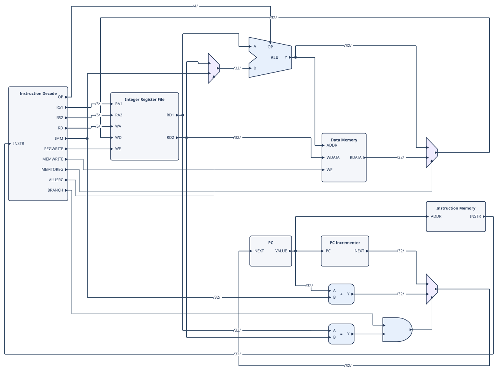

# Circuit Diagram DSL

`cdiag` turns a short text description of a digital circuit into an SVG block diagram.

You list the blocks and connect their ports. `cdiag` does the layout and drawing. The output is a diagram for people to read. It is not HDL, and nothing is simulated or synthesized.



*A single-cycle RISC-V datapath, written in about 60 lines: [`examples/simple_riscv_datapath.cdl`](examples/simple_riscv_datapath.cdl)*

## Contents

- [Quick start](#quick-start)
- [Writing a diagram](#writing-a-diagram)
- [Built-in blocks](#built-in-blocks)
- [Custom blocks](#custom-blocks)
- [Bit slices and concatenation](#bit-slices-and-concatenation)
- [Diagram settings](#diagram-settings)
- [Command line](#command-line)
- [Use from an application](#use-from-an-application)
- [Development](#development)

## Quick start

### 1. Set up

With Docker:

```sh
docker compose run --rm typescript
```

Or with Node.js installed:

```sh
npm install
npm run build
```

### 2. Write a diagram

Save this as `hello.cdl`:

```text
version 1

diagram "A small datapath" {
    input left[8], right[8]
    output result[8]

    sum: ADD(width=8)

    left -> sum.A
    right -> sum.B
    sum.Y -> result
}
```

### 3. Check and render it

```sh
npm run cdiag -- check hello.cdl
npm run cdiag -- render hello.cdl -o build/hello.svg
```

With Docker, put `docker compose run --rm typescript` in front of each command. Open `build/hello.svg` in a browser.

### More examples

| File | Shows |
|---|---|
| [`simple_riscv_datapath.cdl`](examples/simple_riscv_datapath.cdl) | A RISC-V datapath with feedback |
| [`logic_primitives.cdl`](examples/logic_primitives.cdl) | Logic gates and comparators |
| [`streaming_fir.cdl`](examples/streaming_fir.cdl) | A three-tap FIR pipeline |
| [`dma_engine.cdl`](examples/dma_engine.cdl) | A DMA controller and memory interface |
| [`decode_and_queue.cdl`](examples/decode_and_queue.cdl) | Decoder, demux, FIFO and encoder |
| [`rotation.cdl`](examples/rotation.cdl) | Rotated and flipped blocks |
| [`pipeline_ranks.cdl`](examples/pipeline_ranks.cdl) | A five-stage pipeline kept in order with `rank` and `group` ([rendered](examples/rendered/pipeline_ranks.svg)) |
| [`register_file.cdl`](examples/register_file.cdl) | A 2R1W `REGFILE` and south-side port names ([rendered](examples/rendered/register_file.svg)) |
| [`wide_gates.cdl`](examples/wide_gates.cdl) | AND and OR gates with 3 and 4 inputs |
| [`bit_manipulation.cdl`](examples/bit_manipulation.cdl) | Concatenation, slices and shifts |

Rendered SVGs are in [`examples/rendered/`](examples/rendered).

## Writing a diagram

A file has a `version` line and one `diagram`. The diagram body has three kinds of statements.

**1. Top-level ports**: the diagram's own inputs and outputs. A width goes in square brackets.

```text
input a[32], b[32], select
output result[32]
```

**2. Blocks**: `name: TYPE(parameters)`.

```text
choose: MUX(width=32)
execute: ALU(width=32, op_width=4)
```

**3. Connections**: `source -> sink`. One source can drive several sinks.

```text
a -> choose.A, execute.A
b -> choose.B
select -> choose.S
choose.Y -> execute.B
execute.Y -> result
```

Rules the checker enforces:

- A block port is written `block.PORT`. A top-level port is written by name alone.
- An omitted width is inferred from the connections where possible.
- Widths on both ends of a connection must match.
- A signal can have only one driver.

## Built-in blocks

Built-in blocks come with fixed port names and a standard symbol. Every block port is drawn with a small arrow: pointing into the block for an input, and out of it for an output. In the table, `n` is the `width` parameter.

| Block | Inputs | Outputs | Parameters |
|---|---|---|---|
| `ADD`, `SUB` | `A[n]`, `B[n]` | `Y[n]` | `width` |
| `AND`, `OR` | `A[n]`, `B[n]`, … | `Y[n]` | `width`, `inputs` (2–16; default 2) |
| `XOR` | `A[n]`, `B[n]` | `Y[n]` | `width` |
| `NOT` | `A[n]` | `Y[n]` | `width` |
| `SHIFT`, `SHL`, `SHR`, `SAR` | `A[n]`, `B[m]` | `Y[n]` | `width`, `shamt_width` |
| `CMP` | `A[n]`, `B[n]` | `Y[1]` | `width`, `op` (`eq` or `ne`, default `eq`) |
| `MUX` | `A[n]`, `B[n]`, …, `S[k]` | `Y[n]` | `width`, `inputs` |
| `DEMUX` | `A[n]`, `S[k]` | `Y0[n]`, `Y1[n]`, … | `width`, `outputs` |
| `DECODER` | `A[width]` | `Y[2^width]` (one-hot) | `width` (1–8, default 2) |
| `ENCODER` | `A[width]` (one-hot) | `Y[ceil(log2(width))]`, `VALID[1]` | `width` (2–256, default 4) |
| `ALU` | `A[n]`, `B[n]`, `OP[op_width]` | `Y[n]` | `width`, `op_width` |
| `DFF` | `D[n]`, `CLK[1]` | `Q[n]` | `width` |
| `FIFO` | `DIN[n]`, `PUSH[1]`, `POP[1]`, `CLK[1]` | `DOUT[n]`, `FULL[1]`, `EMPTY[1]` | `width`, `depth` (default 8) |
| `SRAM` | `ADDR[addr_width]`, `WDATA[n]`, `WE[1]`, `CLK[1]` | `RDATA[n]` | `width`, `addr_width` |
| `REGFILE` | `RADDRi[addr_width]`, `WADDRj[addr_width]`, `WDATAj[n]`, `WEj[1]`, `CLK[1]` | `RDATAi[n]` | `width`, `addr_width` (default 5), `read_ports` (default 2), `write_ports` (default 1) |

Defaults: `width` = 32, `addr_width` = 12, `op_width` = 4, and `shamt_width` = `ceil(log2(width))` (at least 1).

`SRAM` is a single-port (1RW) memory. For a multi-ported array use `REGFILE`: `i` counts read ports from 0 to `read_ports - 1` and `j` counts write ports, so `REGFILE(width=64, read_ports=2, write_ports=1)` has `RADDR0`, `RADDR1`, `RDATA0`, `RDATA1`, `WADDR0`, `WDATA0` and `WE0`.

For `MUX`, `S=0` selects `A`, `S=1` selects `B`, and `A` is drawn as the upper input.

### MUX with more than two inputs

`inputs` sets the number of data inputs, from 2 to 16 (default 2). The data inputs are named `A`, `B`, `C`, and so on. The select port `S` is `ceil(log2(inputs))` bits wide.

```text
pick: MUX(width=8, inputs=4)
a -> pick.A
b -> pick.B
c -> pick.C
d -> pick.D
sel[2] -> pick.S
```

### AND and OR with more inputs

`AND` and `OR` take `inputs` just like `MUX`. The data inputs are named `A`, `B`, `C`, and so on, and every input has the same `width`. The symbol grows taller to fit the extra pins.

```text
ready: AND(width=1, inputs=3)
a -> ready.A
b -> ready.B
c -> ready.C
```

See [`wide_gates.cdl`](examples/wide_gates.cdl).

### DEMUX, DECODER, ENCODER and FIFO

- `DEMUX(width=8, outputs=4)` routes `A` to one of `Y0`–`Y3`, chosen by `S`. It is the mirror image of `MUX`; `outputs` is 2–16.
- `DECODER(width=3)` turns a 3-bit `A` into an 8-bit one-hot `Y`.
- `ENCODER(width=8)` turns an 8-bit one-hot (or priority) `A` into a 3-bit index `Y`. `VALID` says whether any input bit is set.
- `FIFO(width=16, depth=8)` is a queue. `depth` is shown on the symbol, for example `FIFO (8)`. The write side (`DIN`, `PUSH`, `FULL`) is drawn on the left, the read side (`DOUT`, `POP`, `EMPTY`) on the right, and `CLK` at the bottom.

See [`decode_and_queue.cdl`](examples/decode_and_queue.cdl) for all four in one diagram.

### Rotating and flipping a block

Put orientation marks after the block type. Each mark starts with `@`.

| Mark | Effect |
|---|---|
| `@90`, `@180`, `@270` | Rotate clockwise |
| `@flipx` | Mirror left and right |
| `@flipy` | Mirror top and bottom |

```text
queue: FIFO(width=16, depth=4) @90
back: ADD(width=8) @flipx
stage: box "Stage" @90 {
    in IN[8]
    out OUT[8]
}
```

Marks can be combined, for example `@90 @flipx`. The rotation is applied first, then the flips, so a flip always mirrors what you see. Rotation and flips move ports to another edge, but ports keep their reading order along it, from top to bottom on a left or right edge and from left to right on a top or bottom edge. After `@flipy`, a `MUX` still lists `A`, `B`, `C` from top to bottom and its `S` moves to the top. After `@90`, a block whose inputs `A`, `B`, `C` ran down the left edge has them running left to right along the top edge. Ports, arrows and the symbol turn together, while text stays upright. A port on the west side moves to the north side after `@90`. Inside the block body, `rotate 90`, `flipx` and `flipy` mean the same thing.

Use this when the layout would otherwise route long wires around a block, or to make a data path run right to left. See [`rotation.cdl`](examples/rotation.cdl).

### Labels

Built-in symbols hide their port names in the SVG, but the names still work in the DSL. To change the text shown on a block, add a `label`:

```text
operand_b: MUX(width=32) {
    label "ALU Operand B"
}
```

## Custom blocks

For any component that is not a built-in, such as a decoder, a cache or a scheduler, use `box "Label"` and declare its ports with `in` and `out`:

```text
instruction_memory: box "Instruction Memory" {
    in ADDR[32]
    out INSTR[32]
}

pc.VALUE -> instruction_memory.ADDR
```

By default inputs are drawn on the west side and outputs on the east. Add `@north`, `@south`, `@west` or `@east` to a port to move it, for example `in CLK@north`. Use this sparingly. The default placement is usually the most readable.

## Bit slices and concatenation

- `bus[7:0]` selects bits 7 down to 0. Both ends are included and bit numbers start at 0.
- `bus[3]` selects one bit.
- `{high, low}` joins signals. The first item becomes the most significant bits. A concatenation can start a connection: `{high, low} -> sink`. To give it a name, write `net NAME[width] = {high, low} -> sink`.

A slice needs a source port with an explicit width.

```text
version 1

diagram "Packet fields" {
    input tag[4], payload[12], packet[16]
    output assembled[16], packet_tag[4], packet_payload[12], valid[1]

    {tag, payload} -> assembled
    packet[15:12] -> packet_tag
    packet[11:0] -> packet_payload
    packet[15] -> valid
}
```

Here `tag` fills bits 15–12 of `assembled` and `payload` fills bits 11–0.

## Diagram settings

Optional settings go inside the diagram body, for example `layout feedback`.

| Setting | Values | Default |
|---|---|---|
| `direction` | `LR`, `RL`, `TB`, `BT` | `LR` |
| `theme` | `light`, `dark`, `mono` | `light` |
| `layout` | `compact`, `balanced`, `feedback` | `balanced` |
| `netlabels` | `on`, `off` | `on` |

- Use `layout feedback` when the circuit has cycles, such as a program counter loop.
- Layout settings guide the renderer. They do not guarantee short wires in every circuit. Look at the result, and if long wires remain, rearrange the blocks or try another layout.
- `netlabels` is kept in the intermediate representation. Net labels are not yet placed on the final SVG.

## Keep stages in order

Automatic placement follows the direction of the wires. A wire that goes back by two or more stages, such as a branch redirect from EX to IF or a stall from a hazard unit, can make the layout put a later stage on the left; `layout feedback` does not prevent this. Give blocks a rank to fix the order:

```text
rank 0: pc, next_pc, imem
rank 1: if_id
rank 2: decode, regfile, hazard

group "IF": pc, next_pc, imem
group "ID": decode, regfile, hazard
```

`rank N: block, ...` places those blocks in column band `N`. Bands follow `direction`: with `LR`, every rank-0 block is to the left of every rank-1 block. A block in a band may still use several columns inside it, and blocks without a rank are placed freely. A rank can also be written inside a block body as `rank 2`. Ranks apply to blocks only, and a block may not have two different ranks.

`group "Label": block, ...` draws a dashed, labelled frame around the listed blocks after layout. The frame is the bounding box of its members; it does not move blocks. Give the members of a group the same rank or consecutive ranks, or the frame may enclose other blocks. Group frames are drawn by `render` and `createRenderer`; `bundle` output has no frames.

`rank` and `group` are statements only when followed by a number or a string, so blocks and ports may still be named `rank` or `group`.

## Command line

```sh
npm run cdiag -- check FILE.cdl
npm run cdiag -- render FILE.cdl -o OUTPUT.svg [--theme light|dark|mono] [--layout compact|balanced|feedback]
npm run cdiag -- dump-ir FILE.cdl [-o OUTPUT.json]
npm run cdiag -- dump-netlist FILE.cdl [-o OUTPUT.json]
npm run cdiag -- bundle FILE.cdl -o BASENAME
```

| Command | What it does |
|---|---|
| `check` | Parses the file and validates it. |
| `render` | Produces the final SVG with Netlist2SVG. |
| `dump-ir` | Writes the intermediate representation as JSON. |
| `dump-netlist` | Writes the Yosys-style netlist JSON. |
| `bundle` | Writes `BASENAME.json` and `BASENAME.skin.svg` for manual rendering. Keep the two files together. |

## Use from an application

This package is not published to the npm registry. Install it from GitHub. The repository is private, so your GitHub account needs access and SSH must be configured:

```sh
npm install git+ssh://git@github.com/wakuto/digital_block_dsl.git#main
```

In Node.js:

```ts
import { renderSvg } from "@wakuto/digital-block-dsl/node";

const svgText = await renderSvg(sourceText, {
  theme: "light",
  layout: "balanced",
});
```

In a browser, pass Netlist2SVG's web renderer to `createRenderer`. Load the Netlist2SVG and ELK bundles first. See the [Netlist2SVG web bundle guide](https://github.com/ajsb85/netlist2svg#web-bundle).

```ts
import {
  createRenderer,
  type Netlist2SvgEngine,
} from "@wakuto/digital-block-dsl";

declare global {
  interface Window { netlist2svg: Netlist2SvgEngine }
}

const renderSvg = createRenderer(window.netlist2svg);
const svgText = await renderSvg(sourceText);
previewImage.src = URL.createObjectURL(
  new Blob([svgText], { type: "image/svg+xml" }),
);
```

The parser, checks, JSON generation and Skin generation can also be used on their own. To embed CDL in an HTML page, put it in a `<script type="text/cdl">` element and pass its text to `renderSvg`.

## Development

Source files, by stage:

| File | Role |
|---|---|
| `src/parser.ts` | Parses and checks CDL |
| `src/netlist.ts` | Generates Yosys-compatible JSON |
| `src/skin.ts` | Generates the Netlist2SVG Skin |
| `src/render-core.ts` | Adapts the renderer |
| `src/cli.ts` | Command line |

Regenerate the README figure after changing the example or the renderer:

```sh
npm run cdiag -- render examples/simple_riscv_datapath.cdl -o examples/rendered/simple_riscv_datapath.svg
```

Run the tests:

```sh
npm test
```

Out of scope for now: hierarchical modules, constants, HDL expressions, bidirectional bundles, manual routing and interactive editing.
