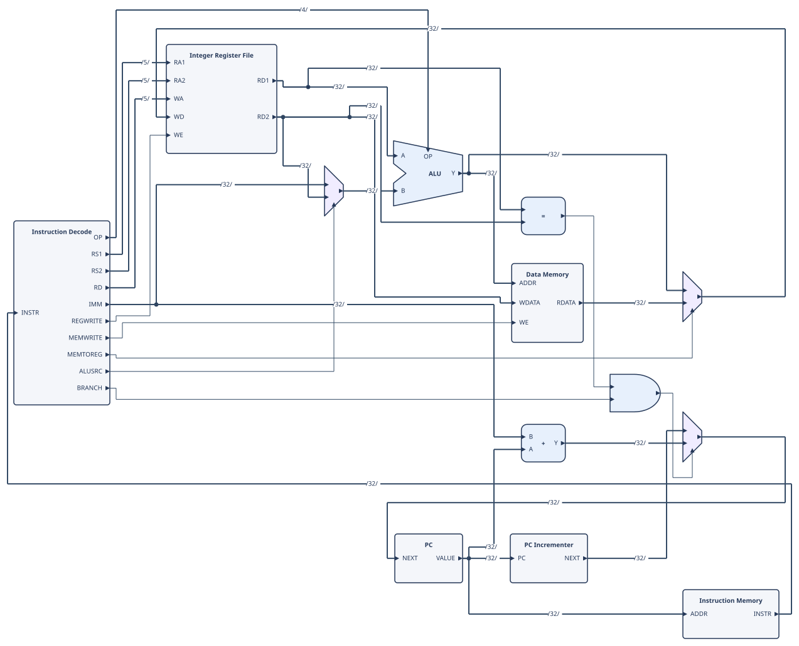

# Circuit Diagram DSL

`cdiag` turns a short text description of a digital circuit into an SVG block diagram.

You list the blocks and connect their ports. `cdiag` does the layout and drawing. The output is a diagram for people to read. It is not HDL, and nothing is simulated or synthesized.



*A single-cycle RISC-V datapath, written in about 60 lines: [`examples/simple_riscv_datapath.cdl`](examples/simple_riscv_datapath.cdl)*

## Contents

- [Quick start](#quick-start)
- [Writing a diagram](#writing-a-diagram)
- [Built-in blocks](#built-in-blocks)
- [Custom blocks](#custom-blocks)
- [Bit slices and concatenation](#bit-slices-and-concatenation)
- [Microarchitecture diagrams](#microarchitecture-diagrams)
- [Diagram settings](#diagram-settings)
- [Keep stages in order](#keep-stages-in-order)
- [Command line](#command-line)
- [Use from an application](#use-from-an-application)
- [Development](#development)

## Quick start

### 1. Set up

With Docker:

```sh
docker compose run --rm typescript
```

Or with Node.js installed:

```sh
npm install
npm run build
```

### 2. Write a diagram

Save this as `hello.cdl`:

```text
diagram "A small datapath" {
    input left[8], right[8]
    output result[8]

    sum: ADD(width=8)

    left -> sum.A
    right -> sum.B
    sum.Y -> result
}
```

### 3. Check and render it

```sh
npm run cdiag -- check hello.cdl
npm run cdiag -- render hello.cdl -o build/hello.svg
```

With Docker, put `docker compose run --rm typescript` in front of each command. Open `build/hello.svg` in a browser.

### More examples

| File | Shows |
|---|---|
| [`simple_riscv_datapath.cdl`](examples/simple_riscv_datapath.cdl) | A RISC-V datapath with feedback |
| [`logic_primitives.cdl`](examples/logic_primitives.cdl) | Logic gates and comparators |
| [`streaming_fir.cdl`](examples/streaming_fir.cdl) | A three-tap FIR pipeline |
| [`dma_engine.cdl`](examples/dma_engine.cdl) | A DMA controller and memory interface |
| [`decode_and_queue.cdl`](examples/decode_and_queue.cdl) | Decoder, demux, FIFO and encoder |
| [`rotation.cdl`](examples/rotation.cdl) | Rotated and flipped blocks |
| [`pipeline_ranks.cdl`](examples/pipeline_ranks.cdl) | A five-stage pipeline kept in order with `rank` and `group` ([rendered](examples/rendered/pipeline_ranks.svg)) |
| [`register_file.cdl`](examples/register_file.cdl) | A 2R1W `REGFILE` and south-side port names ([rendered](examples/rendered/register_file.svg)) |
| [`wide_gates.cdl`](examples/wide_gates.cdl) | AND and OR gates with 3 and 4 inputs |
| [`bit_manipulation.cdl`](examples/bit_manipulation.cdl) | Concatenation, slices and shifts |

Rendered SVGs are in [`examples/rendered/`](examples/rendered).

## Writing a diagram

A CDL file starts with `diagram`. The `version 1` line in older files is optional.

**1. Top-level ports**: the diagram's own inputs and outputs. A width goes in square brackets.

```text
input a[32], b[32], select
output result[32]
```

**2. Blocks**: `name: TYPE(parameters)`.

```text
choose: MUX(width=32)
execute: ALU(width=32, op_width=4)
```

**3. Connections**: `source -> sink`. One source can drive several sinks.

```text
a -> choose.A, execute.A
b -> choose.B
select -> choose.S
choose.Y -> execute.B
execute.Y -> result
```

Rules the checker enforces:

- A block port is written `block.PORT`. A top-level port is written by name alone.
- An omitted width is inferred from the connections where possible.
- Widths on both ends of a connection must match.
- A signal can have only one driver.

## Built-in blocks

Both diagram modes share the same built-in port names, width checks and symbols. Block port arrows point into the block for inputs and out of it for outputs. In the table, `n` is the `width` parameter.

| Block | Inputs | Outputs | Parameters |
|---|---|---|---|
| `ADD`, `SUB` | `A[n]`, `B[n]` | `Y[n]` | `width` |
| `AND`, `OR` | `A[n]`, `B[n]`, … | `Y[n]` | `width`, `inputs` (2–16; default 2) |
| `XOR` | `A[n]`, `B[n]` | `Y[n]` | `width` |
| `NOT` | `A[n]` | `Y[n]` | `width` |
| `SHIFT`, `SHL`, `SHR`, `SAR` | `A[n]`, `B[m]` | `Y[n]` | `width`, `shamt_width` |
| `CMP` | `A[n]`, `B[n]` | `Y[1]` | `width`, `op` (`eq` or `ne`, default `eq`) |
| `MUX` | `A[n]`, `B[n]`, …, `S[k]` | `Y[n]` | `width`, `inputs` |
| `DEMUX` | `A[n]`, `S[k]` | `Y0[n]`, `Y1[n]`, … | `width`, `outputs` |
| `DECODER` | `A[width]` | `Y[2^width]` (one-hot) | `width` (1–8, default 2) |
| `ENCODER` | `A[width]` (one-hot) | `Y[ceil(log2(width))]`, `VALID[1]` | `width` (2–256, default 4) |
| `ALU` | `A[n]`, `B[n]`, `OP[op_width]` | `Y[n]` | `width`, `op_width` |
| `DFF` | `D[n]`, `CLK[1]` | `Q[n]` | `width` |
| `FIFO` | `DIN[n]`, `PUSH[1]`, `POP[1]`, `CLK[1]` | `DOUT[n]`, `FULL[1]`, `EMPTY[1]` | `width`, `depth` (default 8) |
| `SRAM` | `ADDR[addr_width]`, `WDATA[n]`, `WE[1]`, `CLK[1]` | `RDATA[n]` | `width`, `addr_width` |
| `REGFILE` | `RADDRi[addr_width]`, `WADDRj[addr_width]`, `WDATAj[n]`, `WEj[1]`, `CLK[1]` | `RDATAi[n]` | `width`, `addr_width` (default 5), `read_ports` (default 2), `write_ports` (default 1) |
| `MATCH` | `QUERY[n]`, `DATA[entries × n]` | `MATCH[entries]` | `entries`, `width` (both default to 8) |
| `PRIORITY` | `MATCH[entries]` | `INDEX[max(1, ceil(log2(entries)))]`, `VALID[1]` | `entries` (default 8) |

Defaults: `width` = 32, `addr_width` = 12, `op_width` = 4, and `shamt_width` = `ceil(log2(width))` (at least 1).

`SRAM` is a single-port (1RW) memory. For a multi-ported array use `REGFILE`: `i` counts read ports from 0 to `read_ports - 1` and `j` counts write ports, so `REGFILE(width=64, read_ports=2, write_ports=1)` has `RADDR0`, `RADDR1`, `RDATA0`, `RDATA1`, `WADDR0`, `WDATA0` and `WE0`.

For a two-input `MUX`, `S=0` selects `A` and `S=1` selects `B` even when routing changes the drawing order.

### MUX with more than two inputs

`inputs` sets the number of data inputs, from 2 to 16 (default 2). The data inputs are named `A`, `B`, `C`, and so on. The select port `S` is `ceil(log2(inputs))` bits wide.

```text
pick: MUX(width=8, inputs=4)
a -> pick.A
b -> pick.B
c -> pick.C
d -> pick.D
sel[2] -> pick.S
```

### AND and OR with more inputs

`AND` and `OR` take `inputs` just like `MUX`. The data inputs are named `A`, `B`, `C`, and so on, and every input has the same `width`. The symbol grows taller to fit the extra pins.

```text
ready: AND(width=1, inputs=3)
a -> ready.A
b -> ready.B
c -> ready.C
```

See [`wide_gates.cdl`](examples/wide_gates.cdl).

### DEMUX, DECODER, ENCODER and FIFO

- `DEMUX(width=8, outputs=4)` routes `A` to one of `Y0`–`Y3`, chosen by `S`. It is the mirror image of `MUX`; `outputs` is 2–16.
- `DECODER(width=3)` turns a 3-bit `A` into an 8-bit one-hot `Y`.
- `ENCODER(width=8)` turns an 8-bit one-hot (or priority) `A` into a 3-bit index `Y`. `VALID` says whether any input bit is set.
- `FIFO(width=16, depth=8)` is a queue. `depth` is shown on the symbol, for example `FIFO (8)`. The write side (`DIN`, `PUSH`, `FULL`) is drawn on the left, the read side (`DOUT`, `POP`, `EMPTY`) on the right, and `CLK` at the bottom.

See [`decode_and_queue.cdl`](examples/decode_and_queue.cdl) for all four in one diagram.

### Rotating and flipping a block

Put orientation marks after the block type. Each mark starts with `@`.

| Mark | Effect |
|---|---|
| `@90`, `@180`, `@270` | Rotate clockwise |
| `@flipx` | Mirror left and right |
| `@flipy` | Mirror top and bottom |

```text
queue: FIFO(width=16, depth=4) @90
back: ADD(width=8) @flipx
stage: box "Stage" @90 {
    in IN[8]
    out OUT[8]
}
```

Marks can be combined, for example `@90 @flipx`. The rotation is applied first, then the flips, so a flip always mirrors what you see. Rotation and flips move ports to another edge, but ports keep their reading order along it, from top to bottom on a left or right edge and from left to right on a top or bottom edge. After `@flipy`, a `MUX` still lists `A`, `B`, `C` from top to bottom and its `S` moves to the top. After `@90`, a block whose inputs `A`, `B`, `C` ran down the left edge has them running left to right along the top edge. Ports, arrows and the symbol turn together, while text stays upright. A port on the west side moves to the north side after `@90`. Inside the block body, `rotate 90`, `flipx` and `flipy` mean the same thing.

Use this when the layout would otherwise route long wires around a block, or to make a data path run right to left. See [`rotation.cdl`](examples/rotation.cdl).

### Labels

Built-in symbols hide their port names in the SVG, but the names still work in the DSL. To change the text shown on a block, add a `label`:

```text
operand_b: MUX(width=32) {
    label "ALU Operand B"
}
```

## Custom blocks

For any component that is not a built-in, such as a decoder, a cache or a scheduler, use `box "Label"` and declare its ports with `in` and `out`:

```text
instruction_memory: box "Instruction Memory" {
    in ADDR[32]
    out INSTR[32]
}

pc.VALUE -> instruction_memory.ADDR
```

With the default `direction LR`, inputs are drawn on the west side and outputs on the east. Unannotated boxes rotate with the diagram's `direction`, so their inputs stay on the incoming side and outputs on the outgoing side. Add `@north`, `@south`, `@west` or `@east` to a port to place it manually, for example `in CLK@north`. Specifying any port side disables automatic rotation; unannotated ports keep their default west/east sides. An explicit `@90`, `@180` or `@270` still rotates the box.

## Bit slices and concatenation

- `bus[7:0]` selects bits 7 down to 0. Both ends are included and bit numbers start at 0.
- `bus[3]` selects one bit.
- `{high, low}` joins signals. The first item becomes the most significant bits. A concatenation can start a connection: `{high, low} -> sink`. To give it a name, write `net NAME[width] = {high, low} -> sink`.

A slice needs a source port with an explicit width.

```text
diagram "Packet fields" {
    input tag[4], payload[12], packet[16]
    output assembled[16], packet_tag[4], packet_payload[12], valid[1]

    {tag, payload} -> assembled
    packet[15:12] -> packet_tag
    packet[11:0] -> packet_payload
    packet[15] -> valid
}
```

Here `tag` fills bits 15–12 of `assembled` and `payload` fills bits 11–0.

The split and join symbols turn with `direction`. In a vertical diagram, the
bus bar is horizontal and wires enter and leave along the flow axis.

### Microarchitecture primitives and port positions

Use `box "Label" { ... }` for a component that is not a built-in. Port sides can be set with `@west`, `@east`, `@north` or `@south`, for example `in CLK@north`. Built-in symbols may hide their port names in the rendered SVG; the names remain available in the DSL for connections.

Small triangles point into a block at inputs and out of it at outputs.
A `MUX` keeps the same slanted edge angle as it grows to fit more inputs.
Its select port `S` uses `ceil(log2(inputs))` bits. In either mode, placing
all data inputs on the north side and `Y` on the south side turns the symbol:

```text
select: MUX(width=8) { in A@north, B@north, S@west out Y@south }
```

`MATCH` represents one equality comparison per entry. `PRIORITY` represents
selection from a match mask. These primitives describe data flow in the
diagram and do not simulate it.

## Address fields and memory arrays

Inside a custom `box`, add `table(...)` to draw address fields or a memory array:

```text
address: box "メモリアドレス" {
    table(columns="タグ|インデックス|ライン内位置")
    out TAG[20]@south, INDEX[8]@south
}
tags: box "タグアレイ" {
    table(columns="|", rows=5, ellipsis=on, brace="セット", indices="0|1|2||n−1")
    in INDEX[8]@west
    out WAY0[20]@south, WAY1[20]@south
}
address.INDEX -> tags.INDEX
```

`columns` separates column labels with `|`; empty labels produce blank columns.
Labels appear in the first display row. `rows` is the number of visible rows
(1–64, default 1), independent of capacity and signal widths. `ellipsis=on`
displays vertical dots in the penultimate row and requires at
least three rows. `indices` supplies one row label per visible row, separated by
`|`; leave the ellipsis label empty. `brace="Text"` adds a left brace and caption;
`brace=""` draws just the brace. Omit it to hide the brace.

Table port names are hidden. North/south ports attach to column centers in
declaration order when they fit, starting with the first column. Otherwise they
are spaced evenly. West/east ports are spaced along the array edge. Use explicit
port sides to connect a field to comparators or a memory index. Titles support
`\n` for line breaks. Routing and placement remain automatic; this feature does
not reproduce a reference image's exact coordinates.

See [the two-way cache](examples/set_associative_cache.cdl) and
[the TLB](examples/tlb.cdl). Both use the same parser, width checks and
Netlist2SVG renderer as ordinary blocks. The examples show structural data flow;
valid bits, replacement logic and page-walk control are omitted. The TLB example
concatenates the physical page number with the original offset.

## Microarchitecture diagrams

Set `mode microarchitecture` inside a diagram to enable structured tables and
address records. Circuit mode remains the default. A
caller can also select the effective mode before validation with
`parse(source, { mode: "microarchitecture" })`, `renderSvg(source, { mode:
"microarchitecture" })`, or the CLI `--mode microarchitecture` option on
`check`, `render`, `bundle`, `dump-ir` and `dump-netlist`.

Structured tables describe fields and signal bindings explicitly:

```text
tags: table "Tagged entries" (selected=1) {
    field valid[1] label "Valid" use "allocated"
    field tag[20] label "Tag" use "address match"
    index SET[7]@west
    read TAGS[2560] from tag all
    write FILL_TAG to tag @north
}
```

The quoted title and table options are optional. `rows` controls visible
rows (default 5, range 1–64). `ellipsis` defaults to on with at least three
visible rows. `selected` is a zero-based display row, excluding the ellipsis
row. Older diagrams can still supply `entries` to set logical capacity and
preserve capacity-based sizing and display defaults.

Each field has a unique identifier and positive width. `label` and `use` are
optional metadata; field labels appear in the SVG, while `use` remains in the
IR. Field declarations can follow their read/write bindings. An `index` port
may omit its width when the connected signal supplies it. An explicitly
sized index such as `index SET[7]` also works. Multiple indices are supported. Tables
without indices represent associative structures. Each index is drawn as a
decoder triangle attached to the table edge, with the input connected at its
apex. Indices default west and may be placed east. `read NAME from field`
produces a field-width output; `read NAME from field all` produces the
concatenated entries vector. With no table capacity, the compiler takes that
width from a connected sized port or from `read TAGS[2560] from tag all`. Other
all-entry reads from the same table cover the same number of entries. Reads
attach at the field column along the bottom.
`write NAME to field` creates a field-width input attached along the top. All
generated vectors are capped at 65,536 bits. Optional sides must be `@south`
for reads and `@north` for writes. Ordinary `in`/`out` control ports are also
allowed. Structured table SVGs show the optional title, field labels (or IDs if
unlabeled) and widths;
capacity, row numbers, index names, binding names and `use` prose are not drawn.

Several `read` bindings can share one `index` (for example, to read tag and
data from the same row). Multiple bindings to the same column get distinct
pins. To draw independent accesses, declare separate indices and link each
addressed read or write to its decoder with `via`:

```text
regs: table "Register file" {
    field value[32]
    index RA[5]@west
    index RB[5]@west
    index WA[5]@east
    read RD_A from value via RA
    read RD_B from value via RB
    write WD to value via WA
}
```

This 2R1W table has two bottom data outputs, one top data input and three
independent address inputs. The `via` names are retained in the IR and the
diagram uses separate connections without port names around the table.
Whole-table `read ... all` bindings do not use an index. The diagram does
not specify timing or read-during-write behavior.

Address records split an input bus into named, MSB-first field outputs:

```text
va: record "Virtual address" {
    field vpn[20] label "VPN" use "translation lookup"
    field offset[12] label "Offset"
}
```

The record creates `IN[32]@north` and one south output per field. The SVG shows
the bit ranges calculated from declaration order. A record is a diagram
decomposition and does not model or simulate a slicing circuit.

Use the shared built-ins and ordinary boxes to draw the rest of the data path.
Structured tables do not model memory behavior or replacement policy.

Worked structural examples (drawn top to bottom):

- [`microarchitecture_cache.cdl`](examples/microarchitecture_cache.cdl) — two
  ways sharing a set index, tag/valid lookup and cache-line selection.
- [`microarchitecture_tage.cdl`](examples/microarchitecture_tage.cdl) — a base
  predictor and two tagged tables indexed by different history lengths; a MUX
  selects the prediction counter in long/short/base priority order.
- [`microarchitecture_reservation_station.cdl`](examples/microarchitecture_reservation_station.cdl)
  — indexed dispatch writes, a tag wakeup mask, and readiness-based issue.
- [`microarchitecture_mmu.cdl`](examples/microarchitecture_mmu.cdl) — address
  decomposition, TLB lookup and refill, and reconstruction of the physical
  address with the original page offset.
- [`microarchitecture_vertical_ports.cdl`](examples/microarchitecture_vertical_ports.cdl)
  — a table and a bypass MUX with explicitly placed ports on all four edges.
- [`microarchitecture_2r1w.cdl`](examples/microarchitecture_2r1w.cdl)
  — two independently addressed reads and one addressed write on one table.

These examples show connectivity and block roles, not exact hardware
implementations.

## Diagram settings

These optional settings go inside the diagram body:

| Setting | Values | Default |
|---|---|---|
| `direction` | `LR`, `RL`, `TB`, `BT` | `LR` |
| `theme` | `light`, `dark`, `mono` | `light` |
| `layout` | `compact`, `balanced`, `feedback` | `balanced` |
| `netlabels` | `on`, `off` | `on` |

- Use `layout feedback` when the circuit has cycles, such as a program counter loop.
- Layout settings guide the renderer. They do not guarantee short wires in every circuit. Look at the result, and if long wires remain, rearrange the blocks or try another layout.
- `netlabels` is kept in the intermediate representation. Net labels are not yet placed on the final SVG.

## Keep stages in order

Automatic placement follows the direction of the wires. A wire that goes back by two or more stages, such as a branch redirect from EX to IF or a stall from a hazard unit, can make the layout put a later stage on the left; `layout feedback` does not prevent this. Give blocks a rank to fix the order:

```text
rank 0: pc, next_pc, imem
rank 1: if_id
rank 2: decode, regfile, hazard

group "IF": pc, next_pc, imem
group "ID": decode, regfile, hazard
```

`rank N: block, ...` places those blocks in column band `N`. Bands follow `direction`: with `LR`, every rank-0 block is to the left of every rank-1 block. A block in a band may still use several columns inside it, and blocks without a rank are placed freely. A rank can also be written inside a block body as `rank 2`. Ranks apply to blocks only, and a block may not have two different ranks.

`group "Label": block, ...` draws a dashed, labelled frame around the listed blocks after layout. The frame is the bounding box of its members; it does not move blocks. Give the members of a group the same rank or consecutive ranks, or the frame may enclose other blocks. Group frames are drawn by `render` and `createRenderer`; `bundle` output has no frames.

`rank` and `group` are statements only when followed by a number or a string, so blocks and ports may still be named `rank` or `group`.

Use `direction TB` for top-to-bottom flow, `BT` for bottom-to-top, `LR` for
left-to-right, and `RL` for right-to-left. External inputs and outputs follow
the direction by default. An explicit `@north`, `@south`, `@west`, or `@east`
on a diagram input or output places it on that edge and turns the port symbol
so its connection point faces the diagram. Port labels stay upright. This
works in either diagram mode. Unannotated logic gates, arithmetic symbols,
comparators, MUXes and generic `box` blocks turn with the diagram flow, including their port arrows.
If any port side is specified on a block, that block keeps its manual
placement and the usual defaults for its other pins. Text stays upright.

During rendering, inputs of `CMP`, `AND`, `OR`, `XOR`, `ADD`, and `MUX` can
change drawing order along their side. The renderer tries alternative routes
and keeps the one with fewer crossings, using wire length to break ties.
Port names and connections do not change; MUX select pins stay in place, and
reordered data pins are labeled.

```text
diagram "Vertical data flow" {
    direction TB
    input value[8], alternate[8], use_alternate[1]@west
    output result[8]@south
    select: MUX(width=8)
    value -> select.A
    alternate -> select.B
    use_alternate -> select.S
    select.Y -> result
}
```

## Command line

```sh
npm run cdiag -- check FILE.cdl
npm run cdiag -- render FILE.cdl -o OUTPUT.svg [--theme light|dark|mono] [--layout compact|balanced|feedback] [--mode circuit|microarchitecture]
npm run cdiag -- dump-ir FILE.cdl [-o OUTPUT.json] [--mode circuit|microarchitecture]
npm run cdiag -- dump-netlist FILE.cdl [-o OUTPUT.json] [--mode circuit|microarchitecture]
npm run cdiag -- bundle FILE.cdl -o BASENAME [--mode circuit|microarchitecture]
```

`check` parses and validates a diagram. `render` creates the final SVG using
Netlist2SVG. `dump-ir` and `dump-netlist` inspect intermediate data.

Use a `.drawio.svg` output name to embed an editable draw.io diagram:

```sh
npm run cdiag -- render examples/microarchitecture_2r1w.cdl -o build/register-file.drawio.svg
```

Open the resulting file in draw.io to move symbols, edit labels or reroute wires.
Wire ends snap to fixed connection points at every input and output, including
unused ports. Gate pins favor the 10 pt grid or its 5 pt half-step, with 1 pt
precision where the shape or port spacing needs it. Symbols align to the 10 pt
grid, with 5 pt increments for narrow dimensions that would otherwise change by
more than 10%. Wire tracks use the grid where neighboring wires and shapes
leave room. Branched signals use a shared trunk and editable junctions.
Select a junction and drag it to move all wires attached to it. A bus width
appears once per branched signal.
Tables and records use native draw.io tables with individually editable cells,
whose widths and heights start on 10 pt increments. Table cells use a uniform
30 pt height, including the field header and ellipsis rows.
The file also displays as a regular SVG. Changes made in draw.io stay in the
drawing file. The Node API exposes the same export as
`renderDrawioSvg(source, options)`.

`bundle` writes a matched `BASENAME.json` and `BASENAME.skin.svg`. When
the renderer positions exterior ports or optimizes symbol pin order, it also writes
`BASENAME.layout.json`. Keep the files together and pass the layout file
as `--layout BASENAME.layout.json` when calling Netlist2SVG directly.

## Use from an application

This package is not published to the npm registry. Install it from GitHub. The repository is private, so your GitHub account needs access and SSH must be configured:

```sh
npm install git+ssh://git@github.com/wakuto/digital_block_dsl.git#main
```

In Node.js:

```ts
import { renderSvg } from "@wakuto/digital-block-dsl/node";

const svgText = await renderSvg(sourceText, {
  theme: "light",
  layout: "balanced",
});
```

In a browser, pass Netlist2SVG's web renderer to `createRenderer`. Load the Netlist2SVG and ELK bundles first. See the [Netlist2SVG web bundle guide](https://github.com/ajsb85/netlist2svg#web-bundle).

```ts
import {
  createRenderer,
  type Netlist2SvgEngine,
} from "@wakuto/digital-block-dsl";

declare global {
  interface Window { netlist2svg: Netlist2SvgEngine }
}

const renderSvg = createRenderer(window.netlist2svg);
const svgText = await renderSvg(sourceText);
previewImage.src = URL.createObjectURL(
  new Blob([svgText], { type: "image/svg+xml" }),
);
```

The parser, checks, JSON generation and Skin generation can also be used on their own. To embed CDL in an HTML page, put it in a `<script type="text/cdl">` element and pass its text to `renderSvg`.

The basic browser bundle can turn the default port symbols as the flow changes.
Fixed edge placement and pin-order optimization require an adapter exposing Netlist2SVG’s
`dumpLayout` and precomputed layout support, plus an ELK instance passed as
the second argument to `createRenderer`. The supplied Node renderer and CLI
already provide both. With the basic browser bundle, use an SVG exported by
the CLI for diagrams with explicit port placement.

## Development

Source files, by stage:

| File | Role |
|---|---|
| `src/parser.ts` | Parses and checks CDL |
| `src/netlist.ts` | Generates Yosys-compatible JSON |
| `src/skin.ts` | Generates the Netlist2SVG Skin |
| `src/render-core.ts` | Adapts the renderer |
| `src/cli.ts` | Command line |

Regenerate the README figure after changing the example or the renderer:

```sh
npm run cdiag -- render examples/simple_riscv_datapath.cdl -o examples/rendered/simple_riscv_datapath.svg
```

Run the tests:

```sh
npm test
```

The tests parse and render every file in `examples/` and check the built-in blocks, orientation and port order.

GitHub Actions (`.github/workflows/ci.yml`) runs on every push to `main` and every pull request. It builds and tests on Node.js 22 and 24, checks and renders every example (the SVGs are attached to the run), and builds the Docker image. Run the same steps locally with `npm ci && npm run build && npm test`.

Out of scope for now: hierarchical modules, constants, HDL expressions, bidirectional bundles, manual routing and interactive editing.
