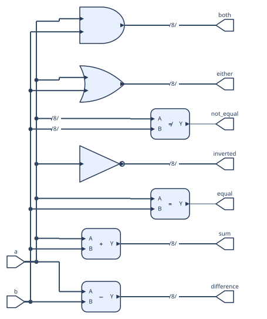

# Circuit Diagram DSL

`cdiag` turns a small text description of a digital system into an SVG block diagram. Describe the blocks you want readers to see and connect their ports. The output is a diagram, not HDL: it does not simulate or synthesize the design.

## Your first diagram

Save this as `hello.cdl`:

```text
version 1

diagram "A small datapath" {
    direction LR

    input left[8], right[8]
    output result[8]

    sum: ADD(width=8)
    left -> sum.A
    right -> sum.B
    sum.Y -> result
}
```

Render it to SVG:

```sh
docker compose run --rm typescript
docker compose run --rm typescript npm run cdiag -- render hello.cdl -o build/hello.svg
```

The first command builds the TypeScript package. For local development with Node.js installed, run `npm install` and `npm run build` once, then use `npm run cdiag -- render hello.cdl -o build/hello.svg`. Open the resulting SVG in a browser or any SVG viewer.

The repository includes larger examples and their rendered diagrams:

- [`simple_riscv_datapath.cdl`](examples/simple_riscv_datapath.cdl) — a small RISC-V datapath.
- [`logic_primitives.cdl`](examples/logic_primitives.cdl) — logic gates and comparators.
- [`streaming_fir.cdl`](examples/streaming_fir.cdl) — a three-tap FIR pipeline.
- [`dma_engine.cdl`](examples/dma_engine.cdl) — a DMA controller and memory interface.
- [`bit_manipulation.cdl`](examples/bit_manipulation.cdl) — bus concatenation, slices and shifts.
- [`pipeline_ranks.cdl`](examples/pipeline_ranks.cdl) — a five-stage pipeline whose stages stay in order despite redirect, stall and write-back paths ([rendered](examples/rendered/pipeline_ranks.svg)).
- [`register_file.cdl`](examples/register_file.cdl) — a 2R1W `REGFILE` and port names on the south side ([rendered](examples/rendered/register_file.svg)).



## Describe blocks and connections

Every file has a version declaration and one diagram. Declare top-level `input` and `output` ports, then blocks and connections:

```text
version 1

diagram "Execution path" {
    input a[32], b[32], select
    output result[32]

    choose: MUX(width=32)
    execute: ALU(width=32, op_width=4)

    a -> choose.A, execute.A
    b -> choose.B
    select -> choose.S
    choose.Y -> execute.B
    execute.Y -> result
}
```

`source -> sink` connects ports. A source can drive multiple sinks, for example `a -> choose.A, execute.A`. Ports on built-in blocks use names such as `A`, `B` and `Y`; custom blocks let you choose names that fit your design:

```text
instruction_memory: box "Instruction Memory" {
    in ADDR[32]
    out INSTR[32]
}
pc[32] -> instruction_memory.ADDR
```

Use `in` and `out` for custom block ports. Widths may be written in square brackets; if a width is omitted, the compiler attempts to infer it from connections.

## Concatenate and slice buses

Use a slice to select a bit range or a single bit. Bit indices start at zero, and both ends of a range are included. Use braces to concatenate signals; the first item is the most significant part.

```text
version 1

diagram "Packet fields" {
    input tag[4], payload[12], packet[16]
    output assembled[16], packet_tag[4], packet_payload[12], valid[1]

    net assembled_packet[16] = {tag, payload} -> assembled
    packet[15:12] -> packet_tag
    packet[11:0] -> packet_payload
    packet[15] -> valid
}
```

Here `tag` occupies bits 15–12 of `assembled`, and `payload` occupies bits 11–0. A connection may also start with the braces directly, without naming the net: `{tag, payload} -> assembled`. A one-bit selection such as `packet[15]` has width one. Slices require the source port to have an explicit width. The compiler checks widths and slice bounds, and rejects conflicting drivers.

## Built-in blocks

Built-ins provide familiar ports and diagram symbols. `n` means `width`; defaults are 32 bits for `width`, 12 bits for `addr_width`, and 4 bits for `op_width`. Shift amount width defaults to `ceil(log2(width))`, with a minimum of one bit.

| Block | Ports (`→` means output) | Parameters |
|---|---|---|
| `ADD` | `A[n], B[n] → Y[n]` | `width` |
| `SUB` | `A[n], B[n] → Y[n]` | `width` |
| `AND`, `OR`, `XOR` | `A[n], B[n] → Y[n]` | `width` |
| `NOT` | `A[n] → Y[n]` | `width` |
| `SHIFT`, `SHL`, `SHR`, `SAR` | `A[n], B[m] → Y[n]` | `width`, `shamt_width` |
| `CMP` | `A[n], B[n] → Y[1]` | `width`, `op` (`eq` or `ne`; default `eq`) |
| `MUX` | `A[n], B[n], S[1] → Y[n]` (`S=0` selects `A`, `S=1` selects `B`) | `width` |
| `ALU` | `A[n], B[n], OP[op_width] → Y[n]` | `width`, `op_width` |
| `DFF` | `D[n], CLK[1] → Q[n]` | `width` |
| `SRAM` | `ADDR[addr_width], WDATA[n], WE[1], CLK[1] → RDATA[n]` | `width`, `addr_width` |
| `REGFILE` | `RADDRi[addr_width]`, `WADDRj[addr_width], WDATAj[n], WEj[1]`, `CLK[1] → RDATAi[n]` | `width`, `addr_width` (default 5), `read_ports` (default 2), `write_ports` (default 1) |

`SRAM` is a single-port (1RW) memory. For a multi-ported array use `REGFILE`: `i` counts read ports from 0 to `read_ports - 1` and `j` counts write ports, so `REGFILE(width=64, read_ports=2, write_ports=1)` is a 2R1W register file with `RADDR0`, `RADDR1`, `RDATA0`, `RDATA1`, `WADDR0`, `WDATA0` and `WE0`. The MUX symbol draws `A` as the upper input.

Use `box "Label" { ... }` for a component that is not a built-in. Port sides can be set with `@west`, `@east`, `@north` or `@south`, for example `in CLK@north`. Built-in symbols may hide their port names in the rendered SVG; the names remain available in the DSL for connections.

## Diagram options

These optional settings go inside the diagram body:

| Setting | Values | Default |
|---|---|---|
| `direction` | `LR`, `RL`, `TB`, `BT` | `LR` |
| `theme` | `light`, `dark`, `mono` | `light` |
| `layout` | `compact`, `balanced`, `feedback` | `balanced` |
| `netlabels` | `on`, `off` | `on` |

Layout settings guide the renderer but cannot guarantee short routes for every circuit. Use `feedback` for diagrams with cycles. `netlabels` is retained in the intermediate representation; automatic placement of named-net labels on the final SVG is not implemented.

## Keep stages in order

Automatic placement follows the direction of the wires. A wire that goes back by two or more stages, such as a branch redirect from EX to IF or a stall from a hazard unit, can make the layout put a later stage on the left; `layout feedback` does not prevent this. Give blocks a rank to fix the order:

```text
rank 0: pc, next_pc, imem
rank 1: if_id
rank 2: decode, regfile, hazard

group "IF": pc, next_pc, imem
group "ID": decode, regfile, hazard
```

`rank N: block, ...` places those blocks in column band `N`. Bands follow `direction`: with `LR`, every rank-0 block is to the left of every rank-1 block. A block in a band may still use several columns inside it, and blocks without a rank are placed freely. A rank can also be written inside a block body as `rank 2`. Ranks apply to blocks only, and a block may not have two different ranks.

`group "Label": block, ...` draws a dashed, labelled frame around the listed blocks after layout. The frame is the bounding box of its members; it does not move blocks. Give the members of a group the same rank or consecutive ranks, or the frame may enclose other blocks. Group frames are drawn by `render` and `createRenderer`; `bundle` output has no frames.

`rank` and `group` are statements only when followed by a number or a string, so blocks and ports may still be named `rank` or `group`.

## Command line

```sh
npm run cdiag -- check FILE.cdl
npm run cdiag -- render FILE.cdl -o OUTPUT.svg [--theme light|dark|mono] [--layout compact|balanced|feedback]
npm run cdiag -- dump-ir FILE.cdl [-o OUTPUT.json]
npm run cdiag -- dump-netlist FILE.cdl [-o OUTPUT.json]
npm run cdiag -- bundle FILE.cdl -o BASENAME
```

`check` parses and validates a diagram. `render` creates the final SVG using Netlist2SVG. `dump-ir` and `dump-netlist` inspect intermediate data. `bundle` writes a matched `BASENAME.json` and `BASENAME.skin.svg` pair for manual or offline rendering; keep the files together.

## Use from an application

The package name below is its module name, not a claim that it is published to the npm registry. Install it from GitHub; because the repository is private, your GitHub account needs access and SSH authentication must be configured:

```sh
npm install git+ssh://git@github.com/wakuto/digital_block_dsl.git#main
```

In Node.js, pass the CDL source text to the bundled renderer:

```ts
import { renderSvg } from "@wakuto/digital-block-dsl/node";

const svgText = await renderSvg(sourceText, {
  theme: "light",
  layout: "balanced",
});
```

For browser rendering, connect the adapter to Netlist2SVG's web renderer:

```ts
import {
  createRenderer,
  type Netlist2SvgEngine,
} from "@wakuto/digital-block-dsl";

declare global {
  interface Window { netlist2svg: Netlist2SvgEngine }
}

const renderSvg = createRenderer(window.netlist2svg);
const svgText = await renderSvg(sourceText);
previewImage.src = URL.createObjectURL(
  new Blob([svgText], { type: "image/svg+xml" }),
);
```

Load Netlist2SVG's browser bundle and ELK bundle before calling `createRenderer`; see the [Netlist2SVG web bundle guide](https://github.com/ajsb85/netlist2svg#web-bundle). The parser, semantic checks, JSON generation and Skin generation can also be used separately. For an HTML page with inline CDL, read the text from a `<script type="text/cdl">` element and pass it to `renderSvg`.

## Development

```sh
docker compose run --rm typescript
docker compose run --rm typescript npm test
npm run cdiag -- check examples/bit_manipulation.cdl
npm run cdiag -- render examples/bit_manipulation.cdl -o build/bit_manipulation.svg
```

The implementation is organized by stage: `src/parser.ts` parses and checks CDL, `src/netlist.ts` generates Yosys-compatible JSON, `src/skin.ts` generates Netlist2SVG Skin, `src/render-core.ts` adapts the renderer, and `src/cli.ts` implements the command line.

Hierarchical modules, constants, HDL expressions, bidirectional bundles, manual routes and interactive editing are outside the current scope.
